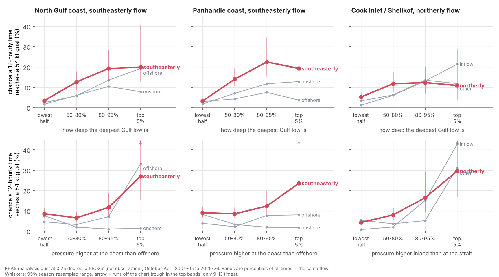

# Gulf of Alaska barrier jets and Cook Inlet / Shelikof gap flow: when do they get strong?

**ERA5 PROXY throughout** (reanalysis 0.25 degree gust and wind, not observation; October-April, 2004-05 to 2025-26, 00 and 12 UTC). Plan and every
definition: `PREREGISTRATION.md`, committed first (`2f74f02`) before any wind direction or pressure was read. The numbers are in `results/`; the exceptions are named under "Checks".
Lows are this study's own ocean pressure minimum, not pipeline A or B. "54 kt" and "64 kt" below are ERA5 gust classes, not warning categories: on open-water buoys the times when
ERA5 shows 54 kt had a median measured gust of 44 to 48 kt, so read the 54 kt class as a high gale. **Everything here is a same-time association (the storm's own numbers at the
time of the gust), context for judgement and not a forecast rule.**

## What the ERA5 proxy shows

**1. In southeasterly zone-mean flow the 54 kt class is reached 1.6 to 2.5 times as often as in other flows.** Chance that a 12-hourly time has a 54 kt gust somewhere in the zone
(`results/analysis.txt`, Q1). The flow is the mean 10 m wind over the zone's ocean cells, not the wind at the gust maximum:

| Zone, flow (zone-mean wind direction) | Reaches 54 kt | Reaches 64 kt | Episodes per season | Share of episodes that reach 64 kt |
|---|---|---|---|---|
| North Gulf coast, southeasterly (from 100-170) | about 9 in 100 | 1 in 100 | 7.5 | 16% |
| North Gulf coast, onshore (from 170-260) | 5 in 100 | 0.5 in 100 | 3.3 | 15% |
| North Gulf coast, offshore (the rest) | 6 in 100 | 0.7 in 100 | 5.8 | 17% |
| Panhandle coast, southeasterly | about 10 in 100 | 2 in 100 | 7.1 | 23% |
| Panhandle coast, onshore | 5.5 in 100 | 0.7 in 100 | 4.5 | 15% |
| Panhandle coast, offshore | 4 in 100 | 0.5 in 100 | 4.3 | 18% |
| Cook Inlet / Shelikof, northerly (from 300 through north to 060) | about 8.5 in 100 | 0.7 in 100 | 5.0 | 12% |
| Cook Inlet / Shelikof, inflow (from 090-200) | 5.5 in 100 | 0.4 in 100 | 4.2 | 12% |
| Cook Inlet / Shelikof, other | 6 in 100 | 0.5 in 100 | 6.1 | 14% |

Episodes are 54 kt times linked within 36 h. Southeasterly flow is not required: 57% (north Gulf) and 55% (Panhandle) of the 54 kt times occur in other flows
(`analysis.txt`, event times by regime). Hurricane force (71.7 kt proxy) is too rare to say anything about: 8, 13 and 5 episodes in 22 seasons for the three zones.

**2. In southeasterly flow the 54 kt class gets more frequent as the deepest Gulf low gets deeper, up to about 967 hPa; deeper than that it stops rising (the 64 kt class keeps rising in the
north Gulf).** The low is the ocean pressure minimum in 44-62N, 175-125W. Chance of a 54 kt gust (64 kt in brackets), southeasterly flow (`results/q1_table.csv`):

| Deepest low | North Gulf coast | Panhandle coast |
|---|---|---|
| Weaker than about 978 hPa | 3.5 in 100 (0.2) | 3 in 100 (0.2) |
| 967 to 978 hPa | 13 in 100 (0.6) | 14 in 100 (2) |
| 957 to 967 hPa | 19 in 100 (3) | 22 in 100 (6) |
| Deeper than 957 hPa | 20 in 100 (5) | 19 in 100 (4) |

Band edges are percentiles of all times in that flow, so they differ a little by zone (978.8/966.9/956.6 and 978.0/966.6/955.7 hPa). The top band holds only 9 to 10 times, so its
range is wide (13 to 41 in 100 for the north Gulf). In northerly Cook Inlet / Shelikof flow the depth dependence is weaker: 5, 12, 12 and 11 in 100 across the same four bands.

**3. When the deepest Gulf low is within about 700 nm of the zone's gust maximum (about the median distance), 54 kt gusts are 1.7 to 3 times as frequent in the two barrier zones and 4 to 11 times as frequent in northerly Cook Inlet flow**
(`q1_table.csv`, LOW_DIST). In the southeasterly flow, 13 in 100 times reach 54 kt with the low within about 680 nm (north Gulf) and 14 in 100 within about 720 nm (Panhandle), against 4 to 9 in 100
farther out; in northerly Cook Inlet flow 14 in 100 within about 650 nm against 1 to 4 in 100 beyond. At 64 kt: 1.7, 3.1 and 1.4 in 100 inside against at most 0.7 outside.

**4. The pressure pattern across the coast or the range.** Top bands of times in the same flow (`q1_table.csv`; the top bands hold 9 to 13 times, so these are rough):
- Pressure higher at the coast than 300 to 400 km offshore by 9.5 hPa or more, in southeasterly flow: about 27 in 100 (north Gulf, range 15 to 53) and 24 in 100 (Panhandle, range 12 to 80) reach 54 kt, against 7 to 12 in 100 in the lower bands. In offshore flow the same band gives 33 in 100 (north Gulf) and 8 in 100 (Panhandle), so it is not specific to southeasterly flow.
- Cook Inlet / Shelikof, northerly flow: inland sea-level pressure (62-66N, 155-145W) higher than at the strait exit (56-59N, 156-150W) by 15.7 to 21.7 hPa: 16 in 100 times reach 54 kt (range 9 to 29); by 21.7 hPa or more: 30 in 100 (range 17 to 75); below 15.7 hPa: 4 to 8 in 100. Inflow flow shows a similar rise (15 and 43 in 100, with different band edges), consistent with the pressure difference mattering more than the wind direction. Inland pressure is sea-level-reduced and cold air inflates it.

**5. In northerly Cook Inlet / Shelikof flow, 54 kt gusts are more frequent when the open Gulf sea is much warmer than the air; singled out after seeing it, a lead, not a confirmation.**
With the open Gulf (50-58N, 160-145W) sea surface warmer than the 2 m air by 3.8 to 6.1 K, 22 in 100 times reach 54 kt (range 16 to 35); by 6.1 K or more, 29 in 100 (range 18 to 45); by less than 1.8 K, 3 in 100; between 1.8 and 3.8 K, 8 in 100.
The pressure difference above and the distance of the low (item 3) are as steep as this, so it is not the only lead. Among Cook Inlet northerly episodes, strong (64 kt) against 54-64 kt ones leans 3.7 times (range 1.6 to 9.2, q 0.010) per 2.2 K (one SD),
but only 13 episodes are strong. Post hoc audit (`results/audit.csv`): adding a late-winter term 3.7; leaving out any one season 3.3 to 6.2; 1 of 1,000 within-season shuffles matched it; even and odd seasons 6.2 and 2.1 (6 and 7 strong episodes, no intervals).
Part of this may be how ERA5 computes gusts, which adds more to the mean wind in unstable air; whether the 10 m mean wind shows the same was not checked. The numbers behind it were not independently recomputed (see "Checks").

## Strong versus storm force among episodes (Q2)

The pre-registered held-out test could not run (it needed 30 of the rarer outcome in each half of the seasons; the biggest class has 18 and 18 strong against 52 and 69 in the other
group, and the Cook Inlet class has 6 and 7). The **all-seasons estimates are the pre-registered fallback and are not held out** (`results/q2_tests.csv`): odds ratio per standard deviation, strong
against 54 to 64 kt episodes, ridge-penalised logistic (penalty 0.5 times the sum of squared slopes added to the summed log-loss; other forms give different odds ratios), adjusted for depth, season-block bootstrap, Benjamini-Hochberg over the 15.

| Factor (one SD, `q2_tests.csv` column sd) | North Gulf southeasterly (27 of 166 strong) | Panhandle southeasterly (36 of 157) | Cook Inlet northerly (13 of 109) |
|---|---|---|---|
| Deeper low (11.2, 9.6, 12.9 hPa) | **2.1 [1.4, 3.7]** | 1.5 [1.0, 2.3] (q 0.057) | **1.35 [1.07, 1.8]** |
| Low farther away (622, 766, 454 km) | 0.84 [0.56, 1.3] | **0.60 [0.33, 0.90]** | 0.72 [0.52, 0.97] (q 0.054) |
| Coast pile-up (4.4, 4.5 hPa) or inland pressure (8.8 hPa) | 1.06 [0.73, 1.5] | 1.38 [1.01, 1.9] (q 0.064) | 1.16 [0.59, 2.7] |
| Sea warmer than air (1.6, 1.9, 2.2 K) | 1.19 [0.89, 1.9] | 1.26 [0.92, 1.7] | **3.7 [1.6, 9.2]** |
| Pressure gradient at the gust maximum (about 1 hPa per 100 km) | **2.5** | **4.0** | **2.6** |

**Bold** = Benjamini-Hochberg q below 0.05 in this not-held-out fallback. **No factor meets the pre-registered "supported" rule, which needs the held-out half**; bold marks leads.
The gradient row is the wind itself seen as pressure (the same gust field defines where it is measured), so it is not a clue. Depth and distance describe the storm at the same time as the gust;
they are not an advance warning. Post hoc audit: Cook Inlet depth (1.35) and distance (0.72) do not survive a within-season shuffle (placebo p 0.21 and 0.19; even-season odds ratio 1.13 and 1.03),
so they reflect differences between winters more than between storms.
**Cannot tell** (intervals include both sides): coast pile-up in the north Gulf, inland pressure in Cook Inlet, sea-air temperature in either barrier zone, distance in the north Gulf.
The smallest odds ratio detectable at 80% power is about 1.8, 1.7 and 2.3 per SD by an approximate formula that ignores season clustering, so the true detectable size is larger.

## Does ERA5 under-read? (Q3, NDBC buoys, `results/buoy_*.csv`)

Seven NDBC buoys, positions as printed on the NDBC station pages (re-checked by `buoy.py check`), 5 m anemometers with no height adjustment (which makes ERA5 10 m wind read relatively low), at the pulled times.
ERA5 assimilates buoy data, so this is not independent of the reanalysis.
- Open-water buoys 46001, 46061, 46076, 46080, 46082, 46083: ERA5 10 m wind is close to the buoy wind (median ratio 0.95 to 1.04 when the buoy reads 20 kt or more; 0.88 to 1.02 at 30 kt or more). ERA5 gust is **8 to 17% higher** than the buoy gust (median ratio 1.08 to 1.17 over the all-times, 20 kt, 30 kt and 45 kt-gust subsets). When ERA5's cell shows 54 kt or more, the buoy's median gust was **44 to 48 kt**, and 0 to 9% of those times had a buoy gust of 54 kt or more. This points the same way as the ASCAT check (`research/era5/ascat_check`, ERA5 gust 15 to 25% above the ASCAT mean wind, itself assimilated).
- Shelikof Strait buoy 46077 (57.87N, 154.21W): its ERA5 cell is 14% land. ERA5 10 m wind is 0.81 to 0.88 of the buoy's (0.81 at 30 kt or more) and gust about equal (0.99 to 1.03); ERA5 reaches 54 kt at only 3 of its 1,233 times and the buoy never did. The commonest Cook Inlet / Shelikof peak cell (57.25N, 155.5W, 34 of 337 episodes) is open water, but how well 25 km cells represent channel winds was not tested beyond this one buoy.
- Buoys are offshore or in open water; they say nothing about the cores of barrier jets within a few tens of nm of the mountains. Coastal mixed cells: 29% of north Gulf southeasterly episode peaks and 42% of north Gulf onshore ones are in an ERA5 cell with at least 10% land (`results/audit.txt`), where land mixes into the gust; the commonest north Gulf peak cell (60.0N, 143.5W, 65 of 366 episodes, land fraction 0.20) is one of them.

## Checks

A fresh Sonnet agent recomputed from the committed files, matching: episode counts, regime counts, all Q1 rates and band edges quoted in the tables, the three Q2 odds ratios it tried (Cook Inlet sea-air 3.7, North Gulf depth 2.1, Panhandle distance 0.60), the half counts, the first buoy comparison, and three DEPTH values from the raw fields (0.00 hPa difference).
A claim reviewer then found the Shelikof buoy 46077 had been placed about 160 km from its true position (put in from memory); it is corrected above and in the results. **Not independently checked:** the corrected buoy numbers (re-verification is recorded in the commit that follows this one), the bootstrap ranges and q values, the audit numbers (late-winter term, leave-one-season-out, placebo, coastal-cell shares), the other twelve Q2 estimates, the detectable-size formula, and ingredients other than DEPTH.
SDs are in `q2_tests.csv`; the ASCAT figure comes from `research/era5/ascat_check`.

## What was not done

Front position (a "front pinching" is only represented by the flow, the low's distance and the cross-coast pressure), low-level stability above the surface (no pressure-level temperature pulled), ASCAT, 1979-2004, hurricane force (too rare), a test of whether the sea-air result survives in the 10 m mean wind, teleconnections.

## Looks and deviations

Q2 is one pre-registered look at all 22 seasons plus one post hoc audit of the same seasons; no held-out data remain. Q1 bands use 600 random controls; the top bands hold 9 to 13 controls each, so their ranges are wide and the bootstrap upper end exceeds 100 in 11 bands (every pressure-gradient top band and two Cook Inlet inflow top bands).
A bug fix before any result was read: the sea-air temperature used a plain mean that returned missing over cells without sea surface temperature; it now uses the mean of valid cells (`features.py`); features.py was first committed together with the results, so this cannot be checked from git.

## Files

`PREREGISTRATION.md`, `stage0_counts.py` (gust counts), `stage1_pull.py` (22.5 GB, 1,800 times), `features.py`, `analyse.py`, `audit.py`, `buoy.py`, `figures.py`. Results in `results/`:
`q1_table.csv`, `q2_tests.csv`, `audit.csv`, `episodes.csv`, `features.csv`, `buoy_summary.csv`, `buoy_when_era5_54.csv`, `analysis.txt`, `audit.txt`. The pulled window of fields
(44-70N, 175-125W, u10, v10, MSLP, 2 m temperature, SST at the 1,800 times) is kept at `/mnt/project-files/goa-jets/` so nothing needs pulling again.
